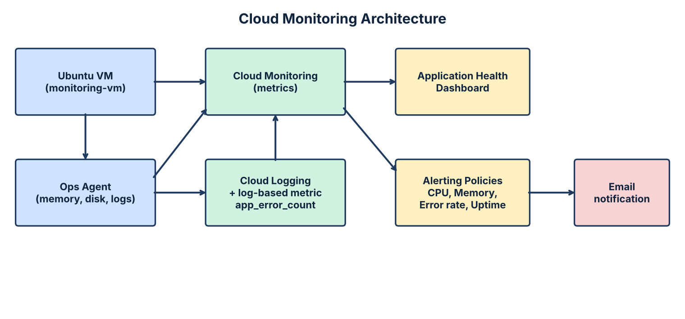

# Cloud Monitoring Dashboards and Alerting Policies on Google Cloud Platform

Google Cloud Certified Associate Cloud Engineer, 2026-2027 Odd Semester: Skill Palaveer Hackathon project

**Author:** `<Your Name>` | **Roll No:** `<Roll No>` | **Project ID:** `<your-project-id>`

## 1. Objective
Build an observability solution on Google Cloud Monitoring that:
1. gives operations a **single application health view** (dashboard),
2. **alerts on error rate**, not only on CPU,
3. avoids **alert fatigue**, and
4. keeps **custom metric cost** under control.

## 2. Architecture



Text version:

```
 Ubuntu VM (monitoring-vm, Compute Engine)
   |-- built-in metrics (CPU, network, uptime, disk IO) ---------+
   |-- Ops Agent (memory, disk used, syslog/nginx logs) ---------+
   |                                                             v
   |                                               Cloud Monitoring + Cloud Logging
   |                                                  |                   |
   |                                      Log-based metric         Metrics store
   |                                      (app_error_count)               |
   |                                                  +---------+---------+
   |                                                            v
   |                                           Dashboard        Alerting policies
   |                                      (Application Health)   (CPU, Memory, Uptime, Error rate)
   |                                                                    |
   +--------------------------------------------------------------------+--> Email notification channel
```

## 3. What is implemented

| Component | Details |
|---|---|
| VM | `monitoring-vm`, Ubuntu LTS, small machine type (e2-micro / e2-small) |
| Dashboard | CPU, Network Received, Network Sent, Memory, Disk, VM Status |
| Alert 1 | **High CPU Usage Alert**: CPU utilization > 0.8 (80%) for 5 min |
| Alert 2 | **VM Uptime Alert**: no uptime data for 5 min (VM down) |
| Alert 3 | **High Error Rate Alert**: log-based metric `app_error_count` |
| Alert 4 | **High Memory Usage Alert**: memory used > 85% for 5 min |
| Notification | Verified email channel |
| Cost control | Budget alert, minimal custom metrics, Cost explorer review |

## 4. Repository layout
```
README.md
docs/        proposal, mid-term report, demo script, use-case mapping, cost & fatigue, viva prep, evaluation checklist
dashboards/  dashboard.json (importable)
alerts/      one JSON per alerting policy
scripts/     deploy, ops agent install, stress test, error generator, export
screenshots/ evidence (add yours here)
```

## 5. Setup, step by step

1. **Project and billing:** select the project, confirm billing is linked (Billing > Account management).
2. **Enable APIs:** `bash scripts/01-enable-apis.sh`
3. **Create VM:** `bash scripts/02-create-vm.sh` (check the cost estimate in the console first).
4. **Install Ops Agent:** SSH into the VM, then `bash 03-setup-ops-agent.sh`
5. **Notification channel:** Monitoring > Alerting > Edit notification channels > Email > add and verify your address.
6. **Dashboard:** import with `gcloud monitoring dashboards create --config-from-file=dashboards/dashboard.json` (edit `INSTANCE_NAME` if different), or build it in the console.
7. **Log-based metric:** `bash scripts/04-create-log-metric.sh`
8. **Alert policies:** replace `CHANNEL_ID` in `alerts/*.json` (find it with `gcloud beta monitoring channels list`), then `bash scripts/05-create-alerts.sh`
9. **Budget:** Billing > Budgets & alerts > create a budget (for example INR 500) with 50/90/100% email thresholds.

## 6. Metric scale note
Compute Engine CPU utilization (`compute.googleapis.com/instance/cpu/utilization`) is a **fraction 0 to 1**. An 80% threshold is written as **0.8**. Ops Agent memory `percent_used` is on a **0 to 100** scale, so 85% is **85**.

## 7. Testing
```
bash scripts/stress-test.sh        # CPU load, opens the High CPU incident after ~5 min
bash scripts/generate-errors.sh    # writes APP_ERROR lines, triggers the error-rate alert
```
Full script: `docs/final-demo-script.md`.

## 8. How incidents work
- An **incident opens** when the condition holds for the full duration (5 min). An email is sent.
- It **closes automatically** when the metric returns to normal (condition no longer met), a resolved email is sent. Autoclose (30 min) closes incidents when data stops.
- Expected delay: metrics ingestion about 1 to 3 min, plus 5 min duration, so **6 to 9 min** from load start to email.

## 9. Problem-statement bottlenecks
See `docs/cost-and-alert-fatigue.md`.

## 10. Cleanup (to avoid charges)
`bash scripts/99-cleanup.sh` deletes the VM, log metric and alert policies.
